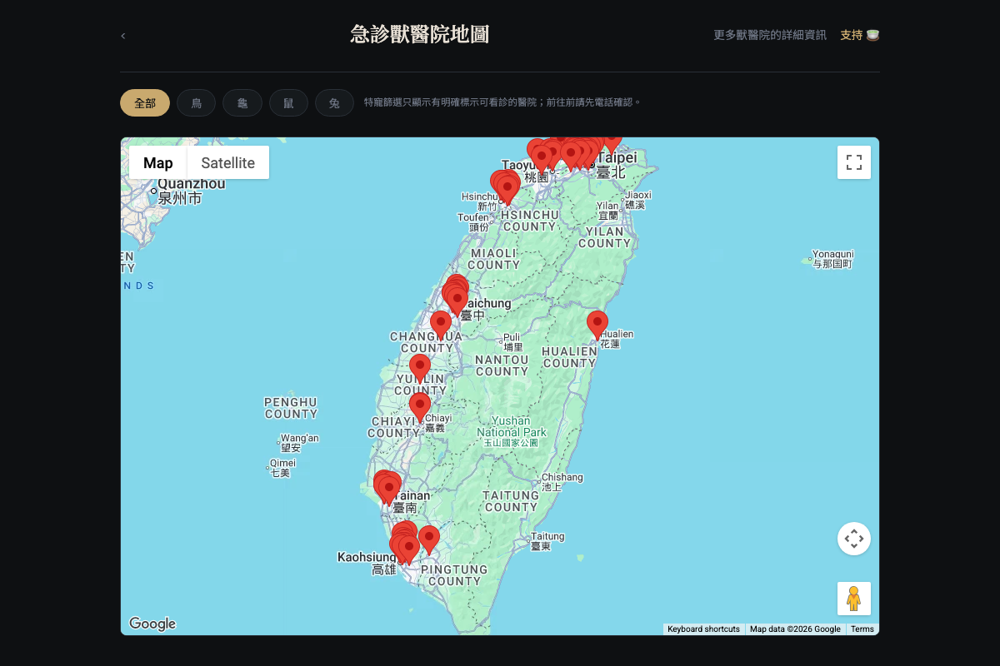

# 24HR 急診獸醫地圖 · Taiwan Emergency Vet Map 🐾

**Live: <https://vetmap.soulbrush.art>**

69 家人工逐間查證的深夜急診獸醫院・中英雙語・每月自動巡檢・免費無廣告
69 hand-verified night-emergency vet clinics across Taiwan · bilingual · monthly automated sweeps · free, no ads



## What this is · 這是什麼

深夜毛孩出事的時候，最不該花時間的事就是「查哪裡還開著」。這張地圖只做一件事：告訴你**現在還亮著的燈在哪裡**——附電話、附備註（要不要先打電話、收不收特寵、急診到幾點），每一筆都由人工打電話或翻官方粉專確認過，不是爬蟲抓來的。

When your animal has an emergency at 3 AM, the last thing you should be doing is researching which clinics are still open. This map does one thing: shows you **which lights are still on right now** — with phone numbers and verified notes. Every entry is confirmed by a human (phone calls, official pages), not scraped.

## Features · 功能

- **地圖頁** `/route/<lang>`：全台急診獸醫院地圖，點 marker 看備註／電話／導航／**即時 Google 評價**（開窗才抓取，從不儲存）
- **特寵篩選**：鳥、龜、鼠、兔等 chips——只顯示**明確查證過**收治該物種的醫院（`species_verified` 為真才列，寧可少列）
- **清單頁** `/details/<lang>`：依縣市分組的完整表格，結尾是**無資源地區表**——哪裡「沒有」深夜急診我們也查證並誠實列出，含各區**晚間層**（無急診地區午夜前仍開著的門診）
- **Load-shedding**：Google Maps 額度耗盡或載入失敗時，自動降級為純清單頁——資訊永不斷線
- **雙語**：中文為權威資料源，英文全站同步
- **隱私**：無 cookie 匿名計數（GoatCounter），不追蹤、不記錄任何個人資料

## Architecture · 架構

```
JSON/clinics.json        ← 唯一資料源（雙語欄位、place_id、last_verified、active、species）
JSON/excluded.json       ← 人工否決名單（月報不再重複端上）
JSON/hours_baseline.json ← 班表基準檔（偵測「悄悄收掉急診」型退化）
main.py                  ← Flask：/api/clinics、頁面渲染、301 舊域名轉址
static/map.js            ← 地圖邏輯：i18n、特寵篩選、即時評價、load-shedding
scripts/check_updates.py ← 月巡：歇業/搬遷/班表退化偵測＋逐縣市新診所發現 → GitHub Issue
```

- 自動化**從不直接改資料**——月報開 Issue、人工查證後才入庫（Google 的班表錯誤率高得驚人，我們戳破過假通宵班表、畜牧診所、甚至被標成獸醫院的人類醫院）
- 瀏覽器金鑰（referrer 鎖定）與伺服器金鑰嚴格分離
- Railway 自動部署；舊 railway.app 網址 301 永久轉址（爆紅貼文裡的連結永遠有效）

**Tech**: Python / Flask · Vanilla JS · Google Maps JS API + Places API (New) · GitHub Actions · Railway

## Data honesty · 資料誠實原則

1. **查證要慢**：一間一間人工確認才上架
2. **下架要快**：「列了但沒急診」比漏列危險——疑慮即下架，查證後再回來
3. **「沒有」也是資訊**：無資源地區表是這張地圖最誠實的部分（馬祖島上目前沒有獸醫院——我們查了，就照實寫）

## Origin story · 動機與目標

*(原文保留自 2023 年初版 README · preserved from the original)*

前陣子，我計劃將全台灣的急診獸醫院資料搜集起來以備不時之需。雖然這是一個平常不想要用到的清單，但卻有其必要性，於是我開始整理，不過卻發現英文的資料少之又少，因此我想：既然我有不錯的英文能力也會寫程式，那不如就把資料彙整成一個大家都能用的地圖網站吧。希望飼主們能夠藉由這個網站的資料更即時的讓需要醫療的動物們獲得照顧。

In my opinion it's important to always have a copy of emergency vet clinics just in case we will need it someday. When I was researching about it, I realized that there's not much English information, so I thought: why don't I create a digital copy of all the information and make it accessible for both Mandarin and English speakers. By building this site, I hope it will help whoever is in need 🙂!

## Support · 支持

地圖免費營運於各服務的免費額度內。想支持的話：[關於頁](https://vetmap.soulbrush.art/about/zh)有一張 NT$150 的《深夜還亮著的燈》手機桌布（同款也[免費下載](https://vetmap.soulbrush.art/wallpapers)——燈亮給所有人，抹茶留給想請的人🍵）。

---

*Maintained by Laisa, with her AI partner 夜燈 🏮 — the night light that keeps watch over this map.*
*發現資料錯誤？[回報表單](https://vetmap.soulbrush.art/contact/zh)找得到我們。Spotted an error? [Tell us](https://vetmap.soulbrush.art/contact/en).*
